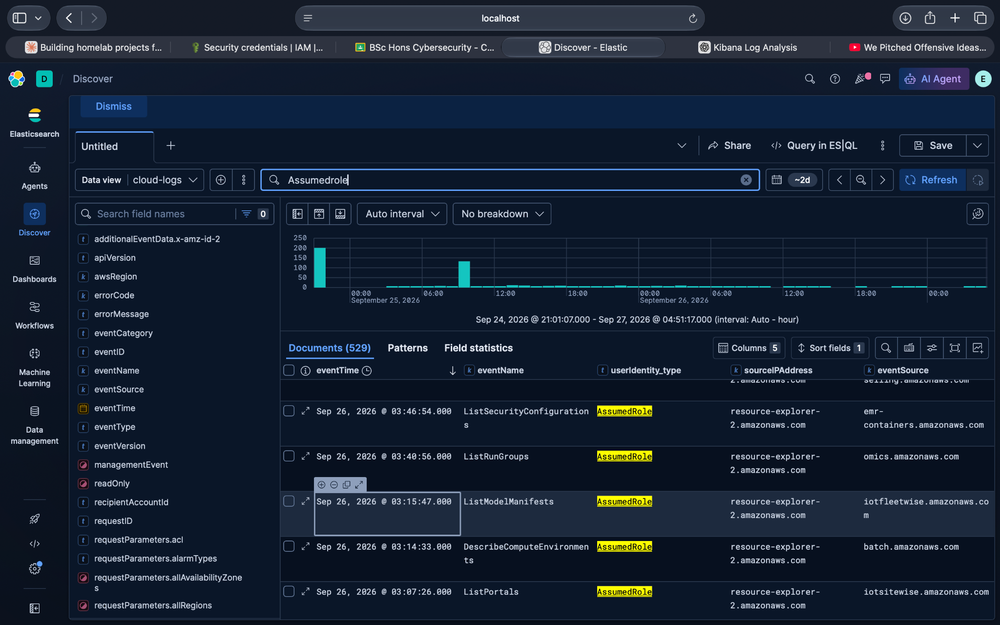
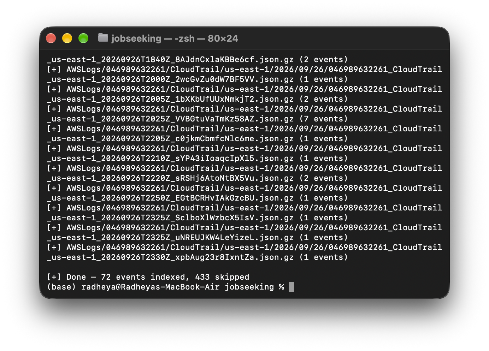

# AWS Cloud Attack Chain: S3 Misconfiguration to Privilege Escalation

### Reconstructed from AWS CloudTrail logs using ELK

A simulated AWS attack chain built in a homelab. A publicly readable S3 bucket contained fake AWS credentials for a low-privilege IAM user. The credentials were used to assume an administrative role and enumerate IAM users.

The main goal was to execute the attack, collect the resulting CloudTrail telemetry, and reconstruct the chain later using Elasticsearch and Kibana.

## Attack Chain

```text
Public S3 bucket
      ↓
ListObjectsV2 / GetObject
      ↓
Credentials recovered
      ↓
dev-user authentication
      ↓
sts:AssumeRole
      ↓
admin-role
      ↓
iam:ListUsers
```

## Lab Stack

- AWS CLI
- Amazon S3
- AWS IAM
- AWS CloudTrail
- Python + boto3
- Elasticsearch
- Kibana

## Investigation

CloudTrail logs were pulled from S3 and indexed into Elasticsearch.

The investigation then followed the activity around the suspicious role assumption:

```text
AssumeRole
    ↓
S3 activity by dev-user
    ↓
GetObject on credentials
    ↓
ListUsers after role assumption
```

### Screenshots

**CloudTrail ingestion**



**Kibana investigation**



## Reconstructed Timeline

| Time | Event | Principal |
|---|---|---|
| T+0 | ListBuckets | `dev-user` |
| T+1 | ListObjectsV2 | `dev-user` |
| T+2 | GetObject | `dev-user` |
| T+3 | AssumeRole | `dev-user` |
| T+4 | ListUsers | `admin-role/attacker-session` |

## MITRE ATT&CK

See [`mitre/attack-mapping.md`](mitre/attack-mapping.md).

## Detection

See [`detection/detections.md`](detection/detections.md).

## Investigation Notes

See [`investigation/kibana-queries.md`](investigation/kibana-queries.md).

## Files

```text
investigation/       Kibana queries and investigation notes
mitre/               ATT&CK mapping
detection/           Detection ideas
screenshots/         Investigation evidence
cloudtrail_targeted.py
```

`cloudtrail_targeted.py` is the local ingestion script used in the lab. It is not included in this package yet, so add your existing copy before pushing if you want it in the repository.

## Disclaimer

This project was performed in a controlled homelab using intentionally created AWS resources and fake credentials. No production credentials or systems were used.
